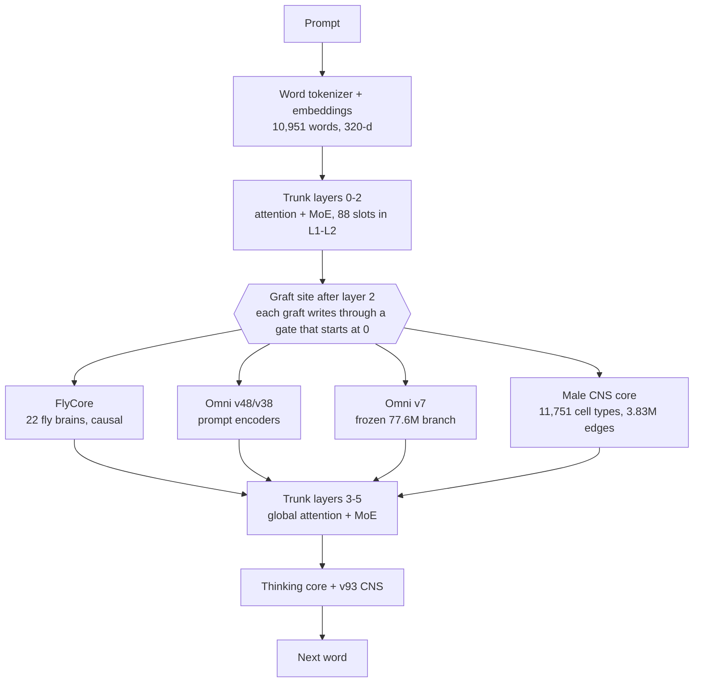

# Supermix Expanse

[](https://huggingface.co/Kai9987kai/supermix-expanse)

**Supermix Expanse** grafts, distils and fine-tunes five sources into one 132.6M-parameter PyTorch model, built and trained entirely on a laptop CPU:

| Source | How it enters Expanse |
|---|---|
| [Archimedes final](https://huggingface.co/Kai9987kai/archimedes-final-model) ([repo](https://github.com/kai9987kai/supermix-archimedes)) — v93 trunk, v87 experts, FlyCore, Omni v48/v38 | the trunk everything is grafted onto; a frozen copy is the anti-forgetting teacher |
| [Omni Collective v7 Frontier](https://huggingface.co/Kai9987kai/supermix-omni-collective-v7-frontier) | frozen 77.6M branch bridged into the residual stream + intent/domain distillation |
| [Qwen2.5-Coder-7B-Instruct](https://huggingface.co/Qwen/Qwen2.5-Coder-7B-Instruct) | 1,500 sandbox-verified code rows + 16 grafted MoE experts from its layer-0/1 MLP neurons |
| [BioMedLM 2.7B](https://huggingface.co/stanford-crfm/BioMedLM) | ~1,400 filtered biomedical rows + 16 grafted MoE experts from its layer-0/1 MLP neurons |
| The **full Janelia male CNS v1.0 connectome** ([natverse/malecns](https://github.com/natverse/malecns), [male-cns.janelia.org](https://male-cns.janelia.org/)) | a per-token recurrent core wired as the whole male fly CNS — all 11,751 cell types, all 3,830,931 type→type edges — plus 6,667 connectome fact rows |

**➡ The trained model is on Hugging Face: <https://huggingface.co/Kai9987kai/supermix-expanse>** (checkpoint, model card, receipts). This repository holds the full project: code, the teacher corpora actually used, the connectome graph, receipts and logs.

> **Status: experimental research model.** Expanse keeps and improves Archimedes' own skills, but its new code-writing and biomedical abilities are weak after one CPU training run — see [Results](#results). Qwen has no Qwen3-Coder at 7-8B, so the official Qwen2.5-Coder-7B-Instruct was used; BioMedLM replaced BioMistral-7B.

## How it works



* **Male CNS core** (`expanse/src/connectome_full.py`). Each token's layer-2 state drives the 1,277 sensory / visual / ascending cell types; activity runs 4 recurrent steps through every type→type edge of the male CNS v1.0 (122.3M typed synapses), each weighted by its **measured input fraction** and signed by the presynaptic neurotransmitter (Dale's law); the 713 descending / motor / efferent types are read out and written back through a zero-initialised gate. The wiring is fixed from data; only per-type gain, bias and leak (plus in/out projections) learn. Per-position, so causal and KV-cache exact. Sparse CSR in 128-column slabs: ~0.33 s forward + 0.35 s backward per 1,024 tokens on CPU.
* **Grafted experts** (`expanse/src/donor_graft.py`). New MoE slots (72 → 88 in layers 1-2) filled with 96-neuron experts carved from Qwen-Coder / BioMedLM layer-0/1 MLPs via ridge maps between single-token states, fold-in init (GELU emulated exactly as `silu(1.702z)/1.702`), local function-fit refinement, load-matched wake biases, dormant until 10-50% of training.
* **Omni v7 branch** (`expanse/src/omni_v7_branch.py`). The frozen v7 net reads the prompt once; its 988-d conclusion is bridged in, and its intent/domain predictions are distilled into the trunk.
* **FlyCore causality fix.** Archimedes' `FlyCore.sense` averaged over *all* positions (future tokens and padding included) — a future-token leak. Expanse senses per position.
* Every graft is born function-preserving: with the fly graft off, the grafted model reproduces Archimedes' logits with max |Δ| = 0.0.

[`expanse/DESIGN.md`](expanse/DESIGN.md) is the full spec.

## Results

Dev loss per source (nats/token on reply tokens; connectome dev = held-out *cell types*):

| source | Archimedes | Expanse |
|---|---|---|
| Archimedes replay (science / code tracing / arithmetic) | 0.787 | **0.418** |
| male-CNS connectome facts (rows both tokenizers cover) | 3.522 | **0.571** |
| fly rows | 4.609 | **1.198** |
| Qwen code rows | — (vocabulary cannot encode them) | 4.04 (from 9.86) |
| BioMedLM bio rows | — | 4.95 (from 8.25) |

* Agreement with Omni v7: intent 72.7%, domain 73.1%. Final gate magnitudes: CNS core 0.086, Omni v7 0.076.
* **Honest graft numbers:** teacher→student representation maps are weak (held-out R² 0.05-0.15); only **1 of 32** grafted experts reproduces its teacher neuron group on held-out tokens (R² 0.21). Most transferred knowledge comes from distillation.
* **Teacher data quality:** code answers kept only if they pass our own tests in a sandbox (92.8% pass); BioMedLM definitions kept if Qwen judged them accurate (94% — a lenient judge); PubMedQA answers capped because BioMedLM answers almost everything "yes" (59.3% on held-out vs a 60.5% always-yes baseline).
* Sample answers: arithmetic and code-tracing prompts are answered correctly in the house style; connectome questions are answered in the right format but sometimes to the wrong question; writing new functions and defining biomedical terms is not usable yet.
* Full held-out generation evaluation and ablations (CNS core off / on a degree-preserving rewired graph, Omni v7 off, donor experts off, fly off): `expanse/checkpoints/eval_report.md` (added when the run completes).

## v2 and v3

Two follow-ups to v1 were trained on the same laptop CPU and compared on **the same held-out rows** (v1's dev split) with `expanse/compare_models.py`, which reports loss **per reply character** so word-level (v1/v2) and BPE (v3) models are comparable. Full tables: [`compare_v1_v2.md`](expanse/checkpoints/compare_v1_v2.md), [`compare_v1_v2_v3.md`](expanse/checkpoints/compare_v1_v2_v3.md).

**v2 — native latent consolidation** (`expanse/src/consolidation_v2.py`, [`V2_DESIGN.md`](expanse/V2_DESIGN.md)). Three zero-gated consolidation blocks (shared 512-d latent, top-2/8 latent MoE, learned memory, +7.3M params) trained for 800 steps against a temporary fusion bank of Archimedes, donor-expert, Omni, FlyCore and male-CNS signals, with a teacher-free final phase. Two bugs were fixed before training (a closed gate could never receive gradient; the distill loss was ~300x the LM loss). Result: v2 is slightly better than v1 (its own held-out dev loss 1.511 -> 1.446; bio token-F1 0.285 -> 0.343), but **zeroing the new blocks removes almost none of the gain** (replay 0.1316 vs 0.1324 nats/char) — the improvement came from 800 more training steps, not from the consolidation blocks.

**v3 — subword tokenizer + more data** (`expanse/src/bpe_tokenizer.py`, `expanse/retokenize_v3.py`, `expanse/make_v3_data.py`, [`V3_DESIGN.md`](expanse/V3_DESIGN.md)). v1 re-tokenised with a byte-level BPE (8,864 tokens, digits kept separate with the leading space on the first digit, **no `<unk>`** — v1 had one in every bio dev row), embeddings re-initialised from the old word embeddings, then 5,000 steps (trunk frozen for the first 300) on 42k rows: ~18k fresh solver/execution-verified problems from the Supermix builders (rows that restate a replay or evaluation problem under new wording were blocked: ~2,000 of them), 5,150 verified Qwen code rows, 2,700 filtered BioMedLM rows and 12k connectome facts. Same seed as v1, so v1's dev rows stayed unseen.

| nats per reply character (lower is better) | v1 | v2 | **v3** |
|---|---|---|---|
| replay (science / code tracing / arithmetic) | 0.166 | 0.132* | **0.033** |
| code | 1.146 | 1.118 | **0.473** |
| male-CNS connectome (held-out cell types) | 0.181 | 0.176 | **0.124** |
| fly | 0.393 | 0.369 | **0.314** |
| bio (all rows) | 0.996 | 0.973 | 1.370 |

| held-out generation (25 items each) | v1 | v2 | **v3** |
|---|---|---|---|
| replay-style problems with fresh numbers | 20% | 28% | **32%** |
| connectome exact match / token-F1 | 16% / 0.674 | 16% / 0.674 | **36% / 0.814** |
| biomedical token-F1 | 0.285 | **0.343** | 0.220 |
| code pass rate, PubMedQA | 0% | 0% | 0% |

\* v2 used a different split seed, so part of its replay gain is on rows it trained on.

v3 is the strongest version on replay, code loss, fly and the connectome, and now writes code in the right shape (*"Find the list of the list. def max_of_value(xs): return max(x)"*) though not yet correctly enough to pass the tests. It **regressed on biomedical answers**: connectome rows (12k) swamp bio rows (2.4k), and part of v1's lower bio loss is `<unk>` making rare terms cheap. Next step: rebalance the mix and continue training.

```bash
# v2 (after the v1 pipeline)
python expanse/train_consolidation_v2.py --steps 800 --batch 4 --threads 8
# v3: fresh data -> more teacher rows -> retokenise v1 -> train -> compare v1/v2/v3
bash expanse/run_v3.sh 480
```

## Connectome Laboratory: does the fly's wiring matter?

Following the method of [QuixiAI/FlyGPT](https://huggingface.co/QuixiAI/FlyGPT), the male-CNS core was turned into a
controlled, **pre-registered** experiment (`expanse/src/connectome_lab.py`, `expanse/cns_lab/`;
[`CNS_LAB_DESIGN.md`](expanse/CNS_LAB_DESIGN.md), full results in [`CNS_LAB_RESULTS.md`](expanse/CNS_LAB_RESULTS.md)).
One configurable core covers every arm — real / degree-preserving shuffled / random / no wiring, Dale-signed or
unsigned edges, measured or reshuffled strengths, fixed or learned per-edge weights (Dale-preserving
`softplus` multipliers that start at exactly 1), three degree normalisations, per-token or persistent CNS state
(carried through KV-cached decoding), a static or input-dependent gate — and its default is bitwise the v3 core. The
anatomy (edge endpoints, synapse counts, measured and learned weights, cell-type names) is saved with the core.
Hypotheses were hash-locked before any run; verdicts are computed from the recorded metrics and never rewritten.

| pre-registered hypothesis (3 paired seeds, frozen v3 trunk, 250 core-only steps) | verdict |
|---|---|
| **H-CNS-001** real wiring beats a degree-preserving shuffle (full 3.83M-edge graph) | **NOT SUPPORTED** — mean Δ +0.00006 nats/char vs threshold 0.00212; 1/3 seeds |
| **H-CNS-002** a trained core beats no core | **SUPPORTED** — 1.8% lower held-out loss, 3/3 seeds |
| **H-CNS-003** persistent CNS state beats per-token reset on memory tasks | **NOT SUPPORTED** — persistent slightly worse, not significant |
| **H-CNS-004** an input-dependent (dynamic) CNS gate beats the static gate (new seeds 2–4) | **SUPPORTED** — 1.7% lower loss, 3/3 seeds |
| **H-CNS-005** with that gate, real wiring beats an empty graph (no edges) | **SUPPORTED, barely** — +0.0012 vs threshold 0.00105 |
| **H-CNS-006** with that gate, real wiring beats a degree-preserving shuffle | **NOT SUPPORTED** — +0.00001 |

An independent audit reproduced every verdict exactly and explains the nulls: the trained core acts mostly as a
learned constant bias (79–83% of its gain survives with every edge zeroed), its per-edge weights could not move (their
gradients sat below the optimiser's epsilon), and neither memory arm learned the tasks. So the result is "the real
wiring gives no measurable advantage *under this protocol*" — the same null FlyGPT reported — not proof that it is
useless. Among 12 one-seed exploratory arms only the **input-dependent gate** stood out, and the pre-registered
follow-up confirmed it: most of its gain (83%) needs no graph (it acts as an adapter on the frozen trunk), the rest
needs *a* graph, and the fly's own wiring adds nothing over a shuffle of it.

**Expanse v4** (`expanse/build_v4.py`) is v3 with that gate on its full-graph CNS core: converted bitwise-exactly from
v3, then only the core trained for 600 steps. Held-out loss drops **2.5%** (0.4102 → 0.3997 nats/char; code −0.029,
bio −0.014; better on 345 of 500 rows), and a matched static-gate control gains only 0.0008 — the gain is the
input-dependent gate, not the extra training. On the v1/v3 comparison rows v4
is better than v3 on replay, code and bio loss and bio F1, equal on generation accuracy, and slightly worse on fly
(and, at noise level, connectome) loss — the gains are in loss, not yet in generated answers
([`CNS_LAB_RESULTS.md`](expanse/CNS_LAB_RESULTS.md#expanse-v4-v3--the-dynamic-cns-gate)). Chat with it locally:
`python expanse/expanse_chat.py --checkpoint expanse/checkpoints/supermix_expanse_v4.pt` (v4 is not on Hugging Face yet).

```bash
python expanse/cns_lab/prereg.py lock H-CNS-001        # freeze a hypothesis before running it
bash expanse/cns_lab/run_sweep.sh 8                    # every pre-registered run, verdicts, then exploratory arms
python expanse/cns_lab/analyze.py                      # summary + per-run drift / pathway / leak reports
python expanse/cns_lab/bench_connectome.py             # CSR vs torch.sparse vs dense backends
bash expanse/run_v4.sh 8                               # v4 + its static-gate control + v1/v3/v4 comparison
```

## Input-evoked CNS experiment

The lab now supports `LabConfig(readout="evoked", state="reset")`: each token's CNS write has the same
core's zero-input response subtracted before gating. This removes the bias-only shortcut identified in the
earlier audit. Both responses remain differentiable and token-local; the existing `absolute` readout is still
the default. The new mode is experimental, with no claim yet of better answers or superior biological wiring.

New experiments record hashes of the checkpoint, corpus, graph source, project code, encoded row order and
batch plan. Completed runs are reused only after validation; stale runs are preserved and rejected. Paired
verdicts check protocol and cohort compatibility. Historical verdict files stay immutable: under these stricter
checks a fresh audit of **H-CNS-004 is INCONCLUSIVE**, because two pairs have cohort hashes in only one arm;
its original SUPPORTED verdict is historical evidence with that limitation.

The [six-run pilot](expanse/checkpoints/cns_lab/X-CNS-002.report.md) completed: mean development loss is
0.425371 for absolute real, 0.425105 for evoked real, and 0.424951 for evoked shuffled. The evoked real
arm improves this small pilot's loss by about 0.06%, but replay regresses slightly and shuffled wiring
still leads. No model was promoted. See the [design, interpretation and research sources](expanse/EVOKED_CNS_DESIGN.md)
and locked [X-CNS-002 protocol](expanse/cns_lab/hypotheses/X-CNS-002.json). Reproduce individual runs and summarize them:

```bash
python expanse/cns_lab/run_lab.py --hypothesis X-CNS-002 --arm evoked_real --seed 31 --threads 4
# Run every arm (absolute_real, evoked_real, evoked_shuffled) for both seeds (31, 32), then:
python expanse/cns_lab/report_pilot.py --hypothesis X-CNS-002
```

Use `--runs PATH` for a fresh output directory if old run inputs no longer match. A pilot report requires
complete, matched receipts and cannot issue a confirmatory verdict or promote a model.

## Controlled continuation and reasoning diagnostics

Continued training now supports explicit source row probabilities, exact sampler
resume, measured row/token exposure, and `--wake preserve` to retain already-active
donor experts. Natural sampling remains the default. The chat uses the loaded
model's context limit and rejects overlong prompts instead of silently truncating them.

The new semantic diagnostic freezes arithmetic and Python trace groups with
paraphrases, numeric changes, and operation changes. It retains raw replies and
reports correctness separately from consistency. A matched study runner binds
source, data, checkpoint and evaluation bytes and keeps candidate checkpoints
separate from the live model. See [the design and reproducible commands](expanse/MIXTURE_STUDY.md).
These are experimental training and evaluation tools; they do not by themselves
establish a stronger model.

The completed 80-step matched pilot reduced pooled dev loss by 0.319% with
balanced sampling, but all three checkpoints scored **4/72** on the frozen
strict final-answer diagnostic. Neither candidate was promoted. See the
[full results and raw-answer evidence](expanse/checkpoints/mixture-20260927-v2/REPORT.md).

## Set it up yourself

### Requirements

* Python 3.10+ (developed on 3.12), PyTorch 2.4+ (CPU is fine; developed on torch 2.11 CPU).
* **Use fp32.** On CPUs without fast bf16 kernels (e.g. Windows ARM64), bf16 matmul is ~100× slower than fp32.
* Chatting / evaluating: ~3 GB RAM. Full reproduction: 16 GB RAM, ~25 GB free disk.

```bash
git clone https://github.com/kai9987kai/Supermix-expanse.git
cd Supermix-expanse
python -m venv .venv
source .venv/bin/activate            # Windows: .venv\Scripts\activate
pip install -r requirements.txt
```

### Option A — chat with the trained model (5 minutes)

```bash
hf download Kai9987kai/supermix-expanse supermix_expanse_v3.pt --local-dir expanse/checkpoints
python expanse/expanse_chat.py --checkpoint expanse/checkpoints/supermix_expanse_v3.pt   # opens http://127.0.0.1:7861
```

`supermix_expanse.pt` (v1, word-level) is also on the Hub; v3 is the recommended checkpoint.

The chat UI streams answers and has live switches for each graft (CNS core, Omni v7, FlyCore, donor experts). To also compare against Archimedes, download its checkpoint first with `python external/fetch_base.py` (or just `hf download Kai9987kai/archimedes-final-model supermix_archimedes.pt --local-dir external/base`).

From Python:

```python
import sys, torch; sys.path.insert(0, "expanse/src")
import expanse_core as ec
model, tok, _ = ec.load_expanse("expanse/checkpoints/supermix_expanse_v3.pt")  # v1 or v3; word or BPE tokenizer
q = "whats the impulse from 40 N acting for 6 s"
ids, _ = tok.encode_turn(q, None)
out = ec.greedy_decode(model, torch.tensor([ids]), max_new_tokens=80,
                       omni_features=ec.arch.OmniCore.featurize([q]),
                       omni7_state=model.omni7_state_for([q]))
print(tok.decode(out))   # impulse = force x time, 40 x 6 = 240, ... total 240
```

Single-turn, 128-token context; v3 uses a byte-level BPE (v1: word-level vocabulary). The checkpoint is a pickled PyTorch payload (`torch.load(weights_only=False)`) — only load files you trust.

### Option B — rebuild and retrain it (≈ 6-7 h on an 8-core laptop CPU)

The repo already ships the teacher corpora (`expanse/data/`), the male-CNS cell-type graph (`expanse/data/malecns_types.npz`) and the Archimedes/Omni source it depends on, so the teacher steps are optional.

1. **Sources** — Archimedes final, Omni v7, teacher configs and the Qwen coder GGUF (~5.2 GB):
   ```bash
   python external/fetch_base.py
   ```
2. **(Optional) regenerate the teacher corpora** instead of using the shipped ones:
   * Teacher weight slices by HTTP range reads (Qwen: embeddings + layers 0-1, ~2 GB; BioMedLM: full model re-encoded to bf16, ~5.3 GB — the fp32 original is never stored):
     ```bash
     python external/fetch_teacher_weights.py qwen
     python external/fetch_teacher_weights.py biomedlm
     ```
     `qwen` slices and BioMedLM weights are also needed for step 3's expert grafts.
   * A llama.cpp release for your platform from <https://github.com/ggml-org/llama.cpp/releases> (built with `b11115`, `win-cpu-arm64`), unzipped into `external/llama.cpp/` so that `external/llama.cpp/llama-server[.exe]` exists.
   * Generate (BioMedLM → Q8_0 GGUF, verified code rows, BioMedLM rows, Qwen fact-check); ~4 h on CPU:
     ```bash
     python expanse/make_teacher_data.py all --target 1500 --heldout 150 --threads 8 --parallel 4
     ```
3. **Clean, build, calibrate, train, evaluate** — in one unattended script (resumable; it skips finished stages and uses the shipped corpora when present):
   ```bash
   bash expanse/run_pipeline.sh 240          # 240 = training wall budget in minutes
   ```
   or step by step:
   ```bash
   python expanse/clean_bio_rows.py
   python expanse/build_expanse.py --threads 8
   python expanse/train_expanse.py --steps 3221 --fly_rows 1500 --dev_cap 100 --eval_every 250 --save_every 50 --threads 8
   python expanse/eval_expanse.py --threads 8
   ```
   Training writes a rolling resumable checkpoint every 50 steps; rerun the same command to continue after an interruption.
4. **Tests:** `python -m pytest expanse/tests -q` (the core/graft tests need the Archimedes checkpoint and teacher slices from steps 1-2).

**Rebuilding the connectome graph from raw data** (optional): download `body-annotations-male-cns-v1.0-minconf-0.5.feather`, `body-neurotransmitters-male-cns-v1.0.feather` and `connectome-weights-male-cns-v1.0-minconf-0.5.feather` (1.05 GB) from <https://storage.googleapis.com/flyem-male-cns/v1.0/connectome-data/flat-connectome/> into a folder, then:

```bash
python supermix-archimedes/archimedes/src/malecns_connectome.py build --data_dir <folder> --output expanse/data/malecns_types.npz
```

## Repository layout

```
expanse/                 Expanse code (src/), CLIs, tests, DESIGN.md, run_pipeline.sh, expanse_chat.py
expanse/cns_lab/         Connectome Laboratory: locked hypotheses, verdicts, run/analysis/benchmark scripts
expanse/data/            teacher corpora, connectome graph + fact rows, PubMedQA eval set, data receipts
expanse/checkpoints/     build/training receipts (+ eval report); the .pt lives on Hugging Face
external/                source fetch scripts, vendored Omni v7 model code, run logs
supermix-archimedes/     vendored Archimedes source + replay corpus (kai9987kai/supermix-archimedes, MIT)
```

## License

* Code: MIT (see [LICENSE](LICENSE)).
* Model weights and derived data: composite terms — see [LICENSE-MODEL.md](LICENSE-MODEL.md). The weights contain parameters derived from BioMedLM and were trained on its outputs, so the **BigScience OpenRAIL-M use restrictions apply, including: not for medical advice or medical results interpretation**. Qwen2.5-Coder-7B-Instruct is Apache-2.0. The male CNS connectome data is CC BY 4.0 (Janelia FlyEM Project Team and collaborators). PubMedQA is MIT.

## Citations

* Male CNS connectome v1.0 — Janelia FlyEM Project Team and the Cambridge Drosophila Connectomics Group, <https://male-cns.janelia.org/>; natverse `malecns`.
* Bolton et al., *BioMedLM: A 2.7B Parameter Language Model Trained On Biomedical Text* (2024).
* Hui et al., *Qwen2.5-Coder Technical Report* (2024).
* Jin et al., *PubMedQA* (EMNLP 2019).
* Lappalainen et al., *Connectome-constrained networks predict neural activity across the fly visual system* (Nature 2024).
